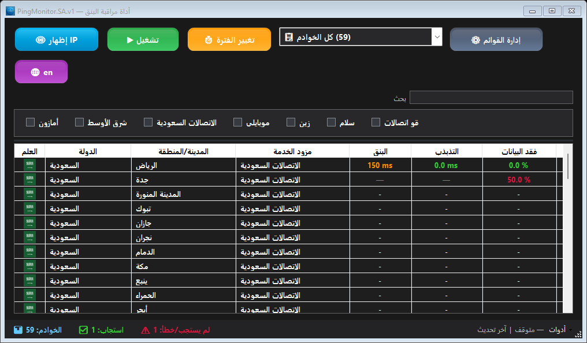
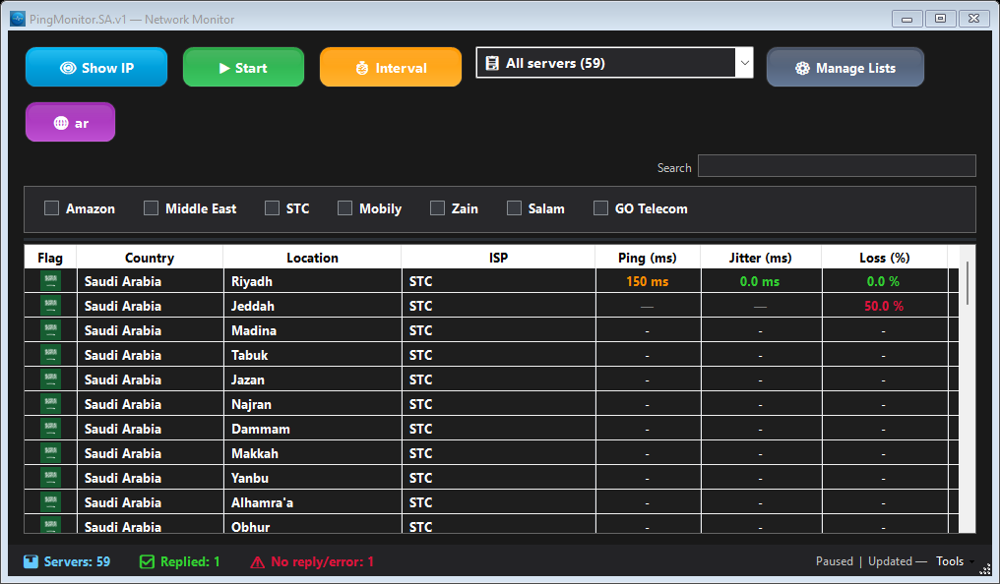

<div align="center">

# PingMonitor.SA.v1

**راقب البنق، تذبذب التأخير وفقد الحزم من مكان واحد.**

تطبيق Windows بواجهة داكنة، يدعم العربية والإنجليزية وقوائم المراقبة المخصصة.

**[تحميل البرنامج EXE](https://github.com/abooodHub/PingMonitor_SA/releases/latest/download/PingMonitor.SA.v1.exe)** · [حزمة ZIP](https://github.com/abooodHub/PingMonitor_SA/releases/latest/download/PingMonitor.SA.v1.zip) · **[الموقع الرسمي](https://abooodhub.github.io/PingMonitor_SA/)** · [تفاصيل الإصدار](https://github.com/abooodHub/PingMonitor_SA/releases/latest)

Windows 10+ · .NET Framework 4.7.2 · التحديث 1.3.1 · ملف EXE واحد



<sub>لقطة من البرنامج ببيانات توضيحية؛ ليست قياسات اتصال حيّة.</sub>

</div>

## ابدأ بثلاث خطوات

1. [حمّل ملف البرنامج](https://github.com/abooodHub/PingMonitor_SA/releases/latest/download/PingMonitor.SA.v1.exe)، أو فك ضغط حزمة ZIP الاختيارية.
2. شغّل `PingMonitor.SA.v1.exe` مباشرة؛ لا تحتاج إلى ملف `.exe.config` بجواره.
3. اختر المزودين من الشريط العلوي، أو أنشئ قائمتك من **إدارة القوائم**، ثم تابع النتائج.

يتطلب Windows 10 أو أحدث و.NET Framework 4.7.2. لا يحتاج البرنامج إلى معالج تثبيت. إعداد التشغيل مضمّن داخل EXE ويُجهّز تلقائيًا في AppData؛ يلزم وجود .NET Framework على الجهاز. تُحفظ قوائمك وتفضيلات العرض داخل بيانات المستخدم، بعيدًا عن مجلد البرنامج.

**للتحديث من 1.3.0:** أغلق البرنامج واستبدل EXE في المجلد نفسه. يمكنك حذف `.exe.config` القديم؛ ملف قوائمك محفوظ داخل AppData.

## ماذا يقدم البرنامج؟

| الميزة | ما يمكنك فعله |
| --- | --- |
| مراقبة متعددة | الاختيار من 59 عنوان خادم فريدًا، مع تصفية المزودين والمناطق وقياس متزامن يصل إلى 8 طلبات. |
| قراءة أوضح للاتصال | متابعة البنق والتذبذب وفقد الحزم، والبحث بالمدينة أو المزود أو العنوان مع فرز رقمي للنتائج. |
| قوائمك الخاصة | إنشاء قوائم مراقبة، واستيرادها وتصديرها مع معاينة قبل الدمج. |
| تفاصيل وتقارير | فتح رسم آخر 180 نتيجة للخادم، وتصدير بياناته أو ملخص الجلسة بصيغة CSV. |
| تنبيهات اختيارية | تفعيل تنبيه Windows بعد ثلاث محاولات ICMP متتالية بلا رد؛ التنبيهات معطلة افتراضيًا. |
| واجهة تتذكر اختياراتك | العربية والإنجليزية، حفظ حجم النافذة والأعمدة والفرز، دعم تكبير العرض وحركة خفيفة قابلة للتقليل. |

يشمل الاختيار STC، موبايلي، زين، سلام، GO، Amazon وخوادم الشرق الأوسط.

<details>
<summary><strong>شاهد الواجهة الإنجليزية</strong></summary>



لقطة ببيانات توضيحية، وليست قياسات اتصال حيّة.

</details>

## استخدام أسرع

انقر مرتين على خادم لفتح تفاصيله، أو استخدم قائمة الزر الأيمن. من **أدوات** في شريط الحالة تستطيع تصدير ملخص الجلسة وإدارة التنبيهات وفتح نافذة «حول البرنامج».

| الاختصار | الوظيفة |
| --- | --- |
| `Ctrl+F` | الانتقال إلى البحث |
| `Esc` | مسح البحث |
| `Ctrl+C` | نسخ عنوان الخادم المحدد |
| `F5` | تحديث النتائج |
| `Ctrl+Shift+M` | تبديل تقليل الحركة |
| `F1` | فتح «حول البرنامج» |

**البحث يغيّر العرض فقط:** تستمر مراقبة الخوادم المحددة حتى إذا أخفاها البحث.

## أسئلة شائعة

<details>
<summary><strong>أين تُحفظ قوائمي وإعداداتي؟</strong></summary>

تُحفظ القوائم وتفضيلات العرض في `%LOCALAPPDATA%\PingMonitor.SA\server-lists.v1.xml` داخل AppData المخفي افتراضيًا، وليس بجوار EXE. توجد نسخة احتياطية للاستعادة عند تلف الملف، ويمكن فتح مجلد البيانات من نافذة «حول البرنامج».

يُحفظ معدل التحديث واختيارات المزودين عبر إعدادات مستخدم Windows. يحتفظ التطبيق بإعداد التشغيل الداخلي في `%LOCALAPPDATA%\PingMonitor.SA\Runtime` ويصلحه تلقائيًا إذا تلف. نقل EXE إلى مجلد مختلف قد يغيّر موقع إعدادات .NET؛ يظل ملف القوائم في مساره الثابت. تصدير القوائم يتضمن أسماء القوائم ومعرّفات خوادمها فقط، دون بيانات الجلسة أو التفضيلات.

</details>

<details>
<summary><strong>هل يحتفظ البرنامج بسجل القياسات؟</strong></summary>

سجل القياسات في الذاكرة أثناء الجلسة فقط. لتحتفظ بالنتائج بعد إغلاق البرنامج، صدّر بيانات الخادم أو ملخص الجلسة إلى CSV.

</details>

<details>
<summary><strong>كيف تُحسب القياسات، وماذا يعني عدم الرد؟</strong></summary>

الفقد يعتمد على آخر 20 محاولة ICMP. أخطاء DNS والتنفيذ لا تُحسب حزمًا مفقودة. التذبذب هو متوسط فروق الاستجابات الناجحة المتجاورة ضمن النافذة نفسها.

عدم استجابة ICMP لا يثبت انقطاع الخدمة؛ قد يمنع الخادم هذا النوع من الطلبات. نافذة التفاصيل تعرض سبب آخر فشل. ويُطلب عنوان WAN عند الضغط على زر إظهاره، عبر HTTPS إلى ipify، دون طلب تحديد موقع إضافي.

</details>

## للمطورين

المشروع مبني بـC# وWindows Forms على .NET Framework 4.7.2. ثبّت Visual Studio أو Build Tools مع أدوات تطوير تطبيقات سطح المكتب لـ.NET وحزمة استهداف 4.7.2، ثم افتح `PingMonitor.sln`، أو نفّذ من جذر المشروع:

```powershell
# البناء وتشغيل الاختبارات
powershell -NoProfile -ExecutionPolicy Bypass -File scripts/Build.ps1 -Test

# البناء والاختبارات وحزم التشغيل والمصدر مع SHA256
powershell -NoProfile -ExecutionPolicy Bypass -File scripts/Build.ps1 -Package
```

تُنشأ الحزم في `release/`، وهو مستبعد من ملفات المصدر.

[دليل التطوير](docs/DEVELOPMENT-AR.md) · [سجل التغييرات](CHANGELOG.md) · [تفاصيل 1.3.1 وحدود التحقق](docs/RELEASE-1.3.1-AR.md) · [قائمة الاختبار اليدوي](docs/MANUAL-RELEASE-CHECKLIST-AR.md)

للإبلاغ عن مشكلة، [افتح بلاغًا](https://github.com/abooodHub/PingMonitor_SA/issues) واذكر إصدار البرنامج وWindows وخطوات إعادة المشكلة.
